# Three design directions: Dr. Maan Albarry website

**Read this first.** These three directions are static HTML/CSS prototypes. An AI agent designed and rendered them, standing in for Claude Design, which could not be used here. No human designer and no design tool produced them, so treat them as directions to choose between, not finished designs. The rendering setup was Playwright 1.64.1 with headless Chromium 156. Desktop shots are 1440×900 at DPR 1, and mobile shots are 390×844 at DPR 2 with `isMobile` on. The harness waited for `document.fonts.ready` and for every image before each shot. Fonts came from Google Fonts. A production build would self-host them.

**What exists**

- Prototypes: `directions/{a,b,c}/`. Each folder holds `home-ar.html`, `home-en.html`, `procedure-ar.html`, `procedure-en.html`, `type.html`, `colours.html`, `nav.html` and one `style.css`.
- Screenshots: `directions/{a,b,c}/shots/`.
- Contact sheets: `directions/comparison-hero.jpg` and `directions/comparison-gallery.jpg`.
- Generator: `directions/_generator/`. These are the Node scripts that write the HTML from the real data modules and take the shots. Their paths are absolute to this machine.
- Query switches on the prototypes: `?theme=dark`, `?menu=open` (mobile menu) and `?nav=open` (desktop procedures menu).

**Content integrity**

- All copy is read at build time from `doctor-data.js`, `src/procedures/content.js`, `src/site/content.js`, `site-routes.js`, or quoted word for word from UI strings in `main.js`. One example is "طرق الحجز / Ways to book" at `main.js:1317`.
- No credentials, numbers, quotes, outcomes or approvals were invented.
- The codes "PL.01" and "FIG. A" are typographic devices only. They make no claim.
- The 15,000+ figure always carries its scope line: "Career total: examinations and procedures combined".
- Images used: `dr-maan-portrait.png` and the 7 procedure renders, in light and dark versions.
- Images **not** used:
  - `dr-maan-faculty.jpg` (no consent).
  - `dr-maan-redsea.jpg` (permission pending).
  - `clinic-exam-room.jpg` and `diagnostics-pentacam.jpg`. The brief allowed these, but `HOMEPAGE_CONTENT_MATRIX.md` row X7 lists them as "unsupported / fabricated context — do-not-restore". I followed the integrity register over the brief. The owner should decide.
- `surgery-phaco.jpg` was not needed.
- The anatomical label positions on the illustrations were placed by eye by the agent. Each label's text comes from that procedure's own `anatomy.parts`, `types` or `LENS_SUMMARY`. **Dr. Maan should check every leader-line target before anything ships.**
  - In the lens-implant render, only "Monofocal" (plain optic) and "Toric" (axis marks) are labelled. I could not tell EDOF from trifocal with confidence.

---

## Research findings the directions answer

Every number below comes from the research documents in this folder.

| # | Finding | Source |
|---|---|---|
| R1 | The reference hero h1 is **95.68 px desktop and 48 px mobile**, capped at **10 ch**. Text covers only **13–20 %** of the first viewport. | MADINAH_CULTIVATOR_SECTION_MAP §2 |
| R2 | The reference has **no CTA in the hero**. Its first in-content CTA comes about **4,500 px** down. The target is one booking pill plus one secondary. | REFERENCE_SITE_AUDIT #3 |
| R3 | **Numbered chapter kickers** appear on **5 of 9** sections, with h2 at **67.2 px**. | REFERENCE_SITE_AUDIT #5 |
| R4 | Arabic needs **body line-height 1.80 vs 1.65** and **headings 1.28 vs 1.20**. Arabic display sizes are set larger. | REFERENCE_SITE_AUDIT #13 |
| R5 | There are only **2 cinematic chapters per page**, taking **42 %** of the scroll. Everything else sits on light grounds. | REFERENCE_SITE_AUDIT #7 |
| R6 | Cards use **radius 30 / 22 px** and an almost invisible shadow (**3 % alpha**). | REFERENCE_SITE_AUDIT #11 |
| R7 | **Only 3 of 7 procedures** have a visual on the current homepage. On phones, laser and CXL also lose their summary line. | HOMEPAGE_CONTENT_MATRIX §7.1, MOBILE_DESIGN M4 |
| R8 | On phones the cataract poster and the Lens Lab and Light Journey art are hidden (**M13**), and so are the Light Journey anatomical labels (**M23**). | MOBILE_DESIGN |
| R9 | The current homepage is **8,015 px tall at 390 px** (about 9.5 screens). Two **hidden sideways scrollers** push content off-screen. | MOBILE_DESIGN |
| R10 | The medical benchmark splits **conditions (5) from procedures (6)**. Procedure pages follow a question outline of about **15 plain-language H3s**. Its weak points: the H1 sits about **1,300 px down**, service tiles are not linked, and counters are unsourced. | MEDICAL_SITE_BENCHMARK |
| R11 | Recommended patterns: sticky split, a scroll-drawn timeline, a numbered editorial accordion, an image-led bento, a thumbnail viewer and a scrollspy. Rejected: carousels, count-ups, glass and glow, scroll-jacking. | 21ST_COMPONENT_RESEARCH §5–6 |
| R12 | The hero portrait source is **295×225 px**, and the figure in it is only about **165 px** wide. The other portrait is **200×200**. The illustrations are **1600×1000** on a uniform **#F3EEE7** (light) or **#181A1E** (dark) ground, sampled from the image pixels. | measured in this pass |

R12 drove one decision shared by all three directions. Every surface that holds an illustration is set to **exactly** the ground colour of the render, so the plates sit edge-free with no visible box.

---

## Direction A: Premium Medical Editorial ("The Monograph")

**Concept.** The site reads like a well-set medical monograph. It leads with the doctor's name in a large Naskh setting, then numbered chapters, hairline rules, an ivory ground and one oxide-bronze accent used only for numerals. There are no cards: procedures sit in grouped editorial rows and illustrations float on the page.

**Rationale.**

- **Name-first hero (R1, R2).** The H1 is set at 80 px Naskh (AR) and 84 px Newsreader (EN). It takes one line in Arabic, as the reference's Arabic h1 does. The hero also carries the booking pill and one quiet secondary, which fixes the reference's missing CTA.
- **Numbered chapters and inner numbering (R3).** Chapters are numbered (01, 02) and so are the items inside them: procedures 01–07, group ranges, and contents 01–08.
- **Line-heights tuned per language (R4).** Arabic body is 1.90 and Arabic display is 1.28–1.35. English body is 1.65.
- **The dense block alternates (R5).** The credentials ledger, a dense band, is followed by a sparse chapter opening.
- **All 7 procedures visible (R7).** All seven have visuals, grouped by the real `PROCEDURE_GROUPS`. That answers the "conditions vs procedures" grouping instinct in R10 without inventing conditions.

### The 10 elements

| Element | A |
|---|---|
| Hero | Text column (7 of 12 columns) on the start side: an italic numbered kicker "01", the H1, the full title, the intro with a hairline above it, then an ink pill and an underlined link. Portrait panel on the end side. Under both, a 4-column **credentials ledger**: 1998, 15,000+ with its scope line, FRCS with the Saudi Board line, and Associate Professor – Taibah University. |
| Procedure gallery | Chapter 02, then **3 group rows** with hairlines between them (01–02, 03–04, 05–07). The group name sits in a 3-column side column. Cataract is the lead item. No boxes: illustration, then a numeral and name, then the summary, then "Read the guide". Image edges are feathered with a 7 % mask so the plates melt into the paper. |
| AR type | **Noto Naskh Arabic** 600 for display (80 / 52 / 26 px; line-height 1.28 / 1.35 / 1.45). **IBM Plex Sans Arabic** 400 for body, 16.5–18 px at 1.90. |
| EN type | **Newsreader** 400 for display (opsz 72; 84 px at 1.02, −0.025 em). **IBM Plex Sans** for body, 17 px at 1.65. |
| Colour and surface | Paper #F3EEE7 (the illustration ground), ink #1B1915, ink-2 #544C42, oxide bronze #8A4B22, hairline #D6CCBE. Dark: #181A1E (the dark illustration ground) and #EFE9E0. |
| Image presentation | Illustrations float without frames. The portrait sits in a stone field, using the multiply-tint method described under "Portrait handling" below. |
| Section layout | 12-column grid, 64 px gutters, max width 1312. Chapters open with a giant italic numeral (132 px). |
| Navigation | Numbered text links 01–06 and one ink "Book" pill. "Procedures" opens a numbered index of all 7 with a cataract preview. Mobile: a full-screen numbered index with 56 px rows, the procedures as a second list, and booking as the last filled row. |
| Mobile composition | Name, title, intro and CTA come first, then the portrait, then a 2×2 ledger. In the gallery, the lead item is full width and the rest are rows with a 116 px thumbnail and a 3-line summary. On the procedure page, contents fold into one `
` row so the plate comes sooner. |
| Procedure-page hero | Breadcrumb, an italic code "01 · group", a 72 px Naskh H1, the intro, the review-status pill, then CTAs. On the side, an "On this page" list 01–08 plus 3D. Next comes a **full-width labelled plate** (Fig. 1), then a **close-up** (Fig. 2): a ×1.9 crop with numbered pins 02 and 03 that match the anatomy list beside it. |

### Screenshots

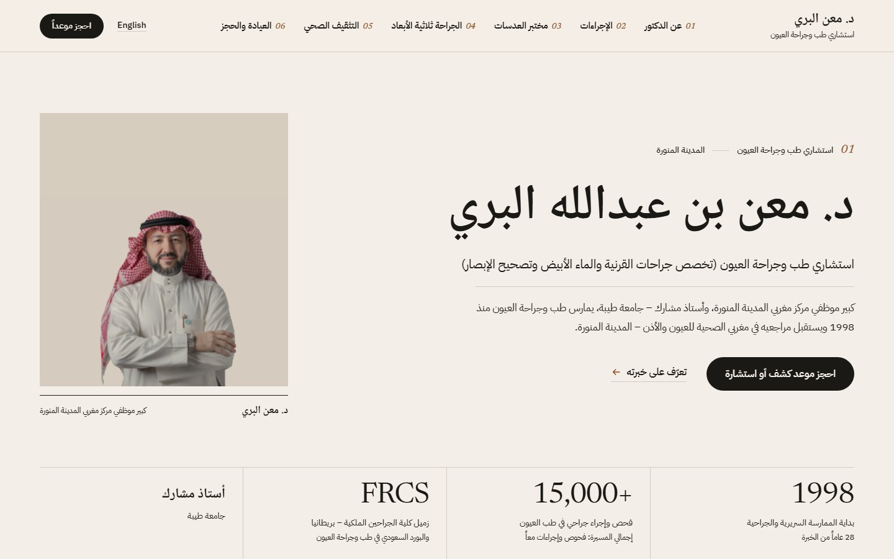
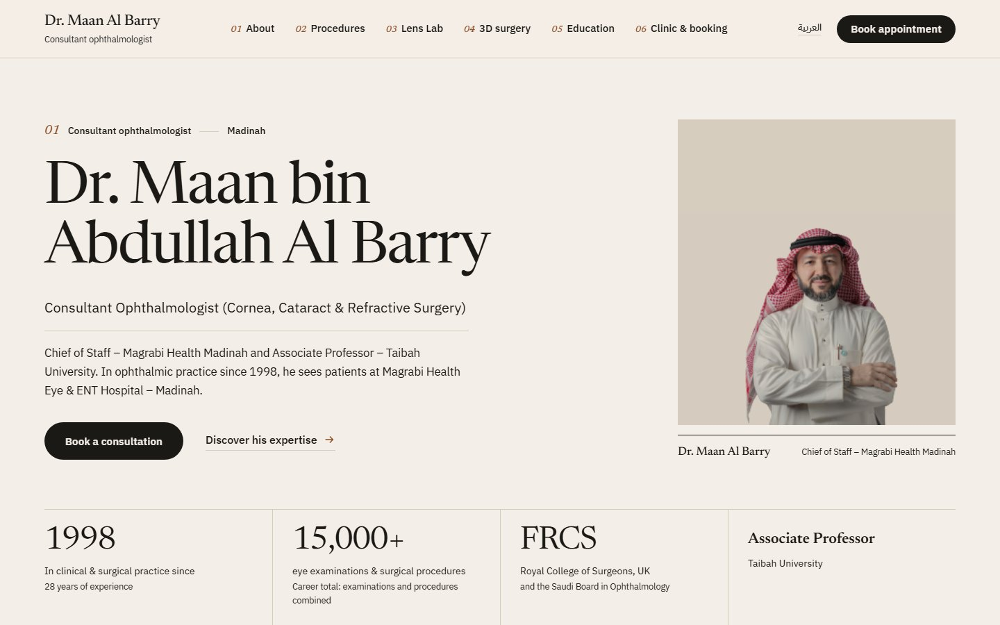
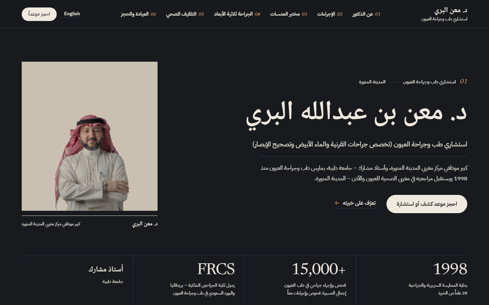
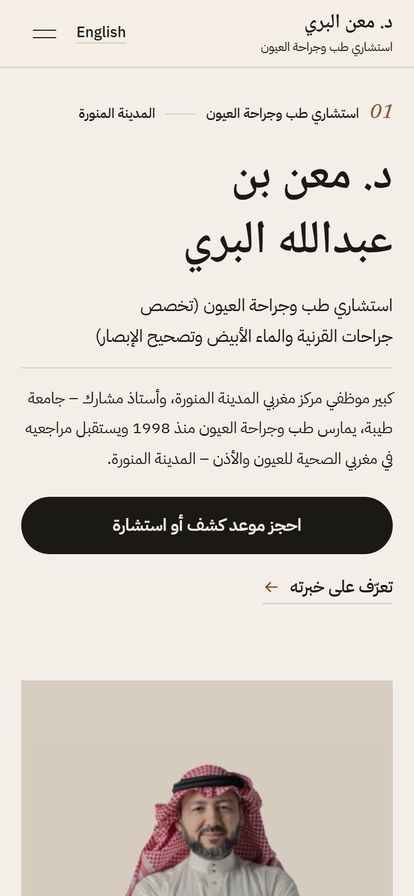
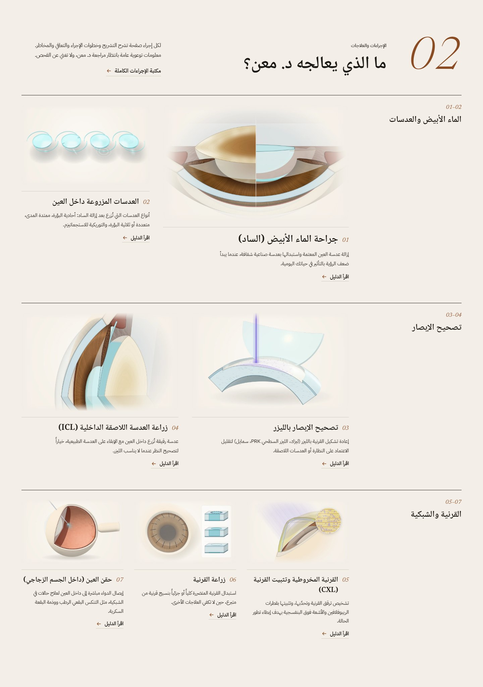
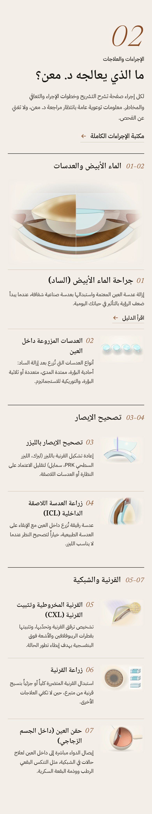
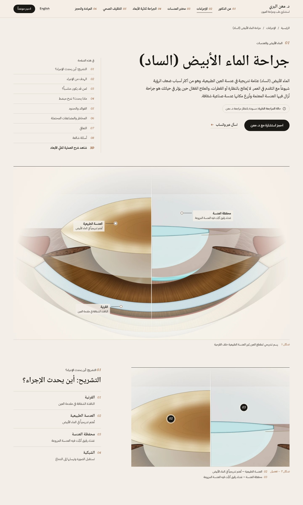
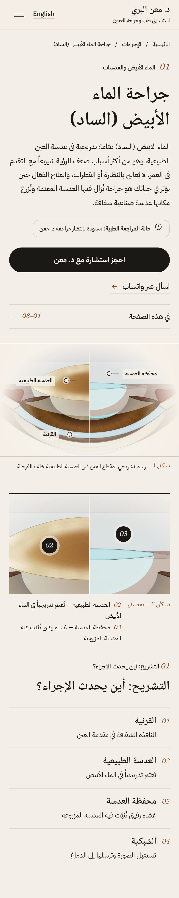
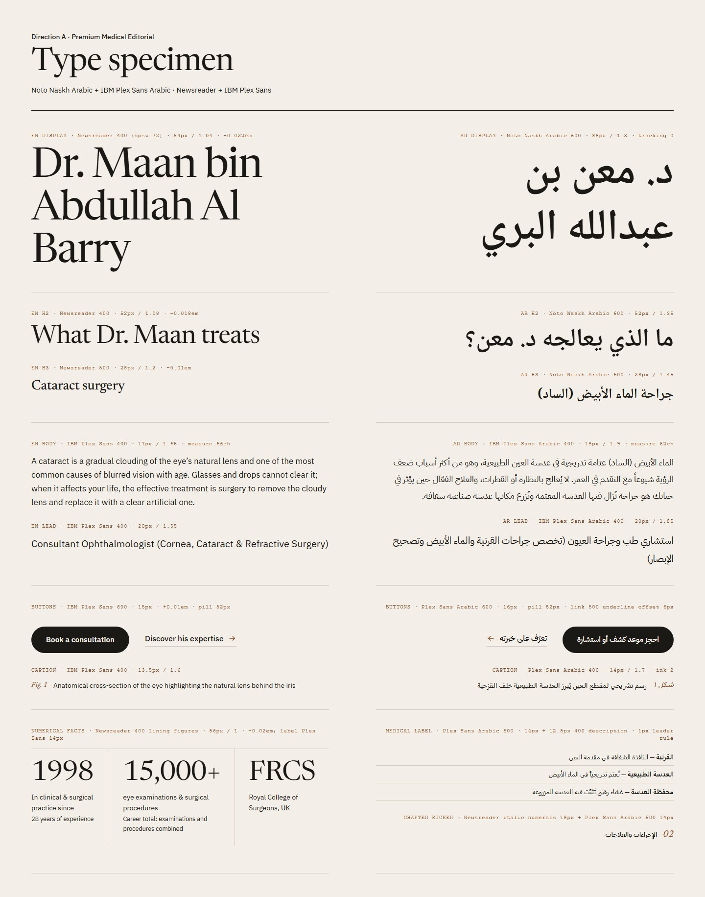
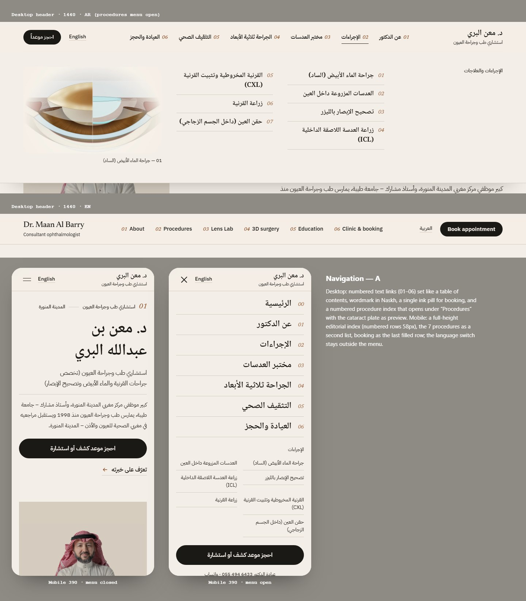
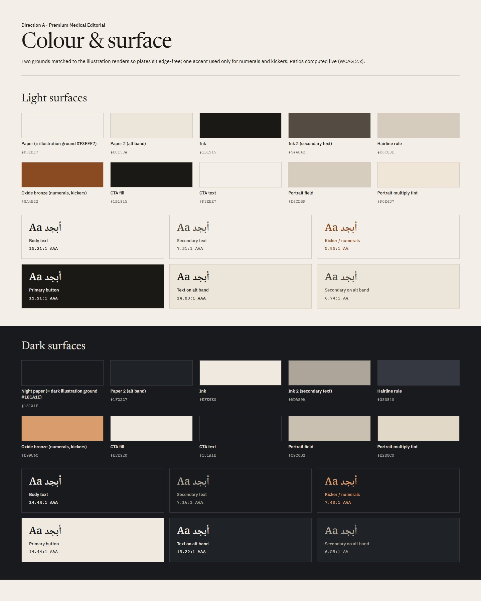

### Strengths

- It has the strongest bilingual typography of the three. Naskh is the most natural Arabic display face here, and Newsreader paired with Plex reads as academic and calm.
- It looks the least like a template. There are no cards, just one accent and real whitespace.
- The credentials ledger turns the facts into a typographic table rather than "stat tiles", which keeps it clear of the rejected count-up pattern.

### Weaknesses and risks

- **Low-resolution portrait.**
  - The portrait renders at 400 px wide, a **1.36× upscale** at DPR 1. On a 2× phone it is about **2.3×**, and it looks soft.
  - The multiply-tint field hides the image edges, but the figure is small inside its field (about 220 px wide on desktop). At this size the portrait is a supporting element, not a statement.
  - A portrait-led editorial direction really needs a new photo at 1600 px or more. **This is the single biggest risk for A.**
- **Mobile length.** The portrait sits below the first screen on mobile, and the page is long.
- **No in-hero route to a procedure.** A patient who arrives with a task scrolls further than in C.
- **Thin hairlines.** The 1 px rules on #D6CCBE are decorative. They are not needed for meaning, so they do not carry contrast requirements.
- **RTL.** Clean throughout. Illustrations are never mirrored. Labels use physical positions in an LTR box, with `unicode-bidi: plaintext` on the text.
- **Contrast, measured with WCAG 2.x:**

  | Pair | Light | Dark |
  |---|---|---|
  | Body text | **15.21:1** | 14.44:1 |
  | Secondary text | **7.31:1** | 7.16:1 |
  | Bronze kicker | **5.85:1** | 7.40:1 |
  | Button | 15.21:1 | 14.44:1 |
  | Secondary on alt band | 6.74:1 | 6.55:1 |

### Implementation cost (vanilla JS/CSS)

**Low to medium.**

- The work is mostly tokens and type plus a restructure of `renderHero` (ledger) and `renderSpecialties` (grouped rows, all 7).
- The only new JS is the menu toggle, and the site already has one.
- 3 font families, with Newsreader as a variable font. Self-hosting needs subsetting.

### Simulator skinning

- Cataract 3D, Lens Lab and Light Journey become "plates" inside numbered chapters: an ivory frame, stage counters in Newsreader italic numerals, and controls as ink pills.
- The 3D stage's dark backdrop can use A's night paper (#181A1E), which is also the dark illustration ground, so the stage meets the page with no seam.
- Lens Lab's comparison table becomes a hairline editorial table.
- Light Journey labels use the same ring-dot leader style as the procedure plates.

---

## Direction B: Interactive Anatomical Atlas ("Plates")

**Concept.** The anatomy tells the story. Every procedure is a **plate** with a plate code, a frame with corner ticks, vermilion label dots, hairline leaders, and a figure caption. Plates lie on a slightly darker "table". The hero is plate 01 with its labels, with an **image index of all 7 plates** underneath it. The procedure page opens on a "night plate", using the dark render, and its close-up is a **loupe**: a circular magnifier with a frame on the source image showing which area is enlarged.

**Rationale.**

- **Answers R7 and R8 most directly.** All 7 visuals sit in the first two screens (the hero index plus the gallery). Labels stay visible on phones, which reverses the M23 hiding, because the big plate keeps its labels and the small plates switch to numbered pins with a legend.
- **Image-driven navigation (R11).** This is the thumbnail viewer and image bento from the 21st research. It adds no carousel.
- **One cinematic chapter only (R5).** The night plate appears once, on the procedure page.

### The 10 elements

| Element | B |
|---|---|
| Hero | Start side: kicker "PL.01 / 07", a 48 px Kufi H1, the title, the intro, a navy CTA and a link. A **signature block** holds a 76 px circular portrait with the name, role and FRCS / Saudi Board. End side: the framed cataract plate (about 790 px) with 3 labels. Across the bottom: a **7-plate index** of thumbnails, codes and names, with the active plate outlined. |
| Procedure gallery | An asymmetric 3-column plate grid laid out `"a a b" "a a c" "d d e" "f g g"`. Cataract is a large plate with full labels and descriptions. The others show numbered pins plus a legend line. The wide plates (ICL, injections) place image and text side by side. |
| AR type | **Noto Kufi Arabic** 600 for display (48 / 42 / 19–28 px; line-height 1.6, because Kufi needs a tall line box). **Noto Sans Arabic** 400 for body, 15–17 px at 1.9. |
| EN type | **Source Serif 4** 600 for display (opsz; 54 px at 1.08). **Public Sans** for body, 16.5 px at 1.65. **IBM Plex Mono** 500 at 11.5 px uppercase for plate codes. |
| Colour and surface | Table #E7E2D9, plate #F3EEE7, ink navy #141B2D, vermilion mark #A33A21, and night plate #181A1E. Dark: table #101215, plate #181A1E, mark #F2916C. |
| Image presentation | Framed plates with corner ticks and a figure caption, with labels as HTML over the images. The loupe crops at ×1.9 inside a 520 px circle. In dark mode, every plate swaps to the dark render. |
| Section layout | Full-bleed 56 px gutters. The plate grid uses a 20 px gap. The hero takes a 4.6 : 7.4 split. |
| Navigation | "Procedures" opens a **7-thumbnail plate index**. Mobile: the menu opens on a 2-column plate grid with all 7 visible, then the page links, then booking. |
| Mobile composition | The plate comes first: a full-bleed cataract plate with short labels, then the name, CTA and signature. The gallery is a 2-column plate grid with the lead plate full width and a 3-line summary on every plate. |
| Procedure-page hero | A **night plate**: breadcrumb, code, a 46 px Kufi H1, the intro, review status, then an inverse CTA and the 3D link. The large dark render carries 3 labels. A contents bar 01–08 runs underneath (two columns on mobile, with no hidden scroller). Then **Fig. B**: the source thumbnail with the crop frame, the loupe with pins 02 and 03, and the anatomy list with matching pin numbers. |

### Screenshots

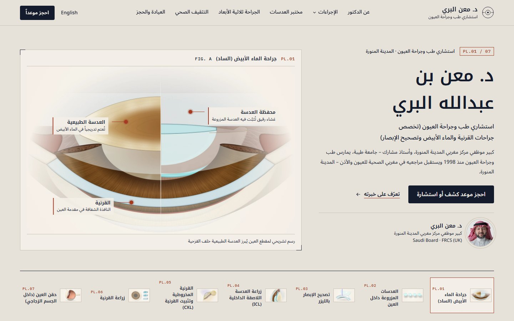
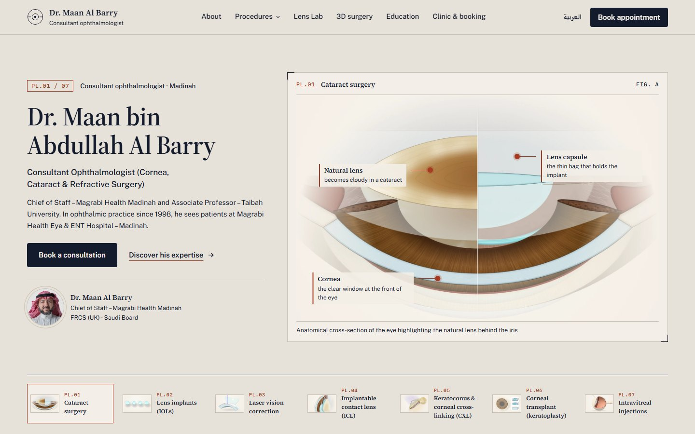
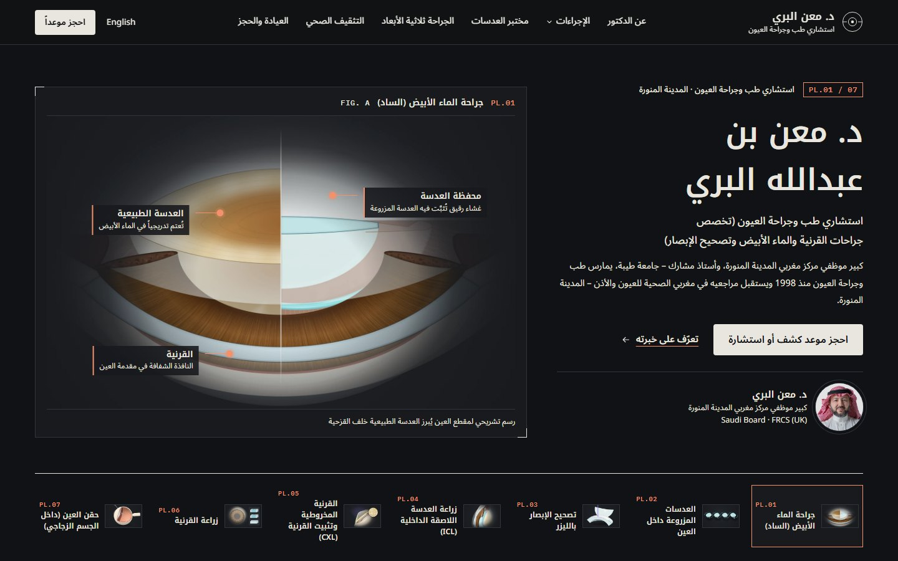
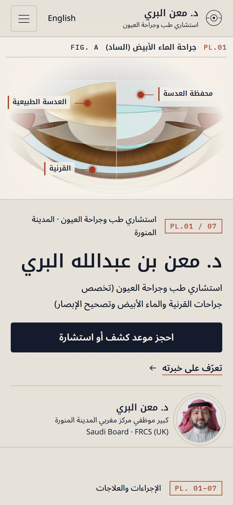
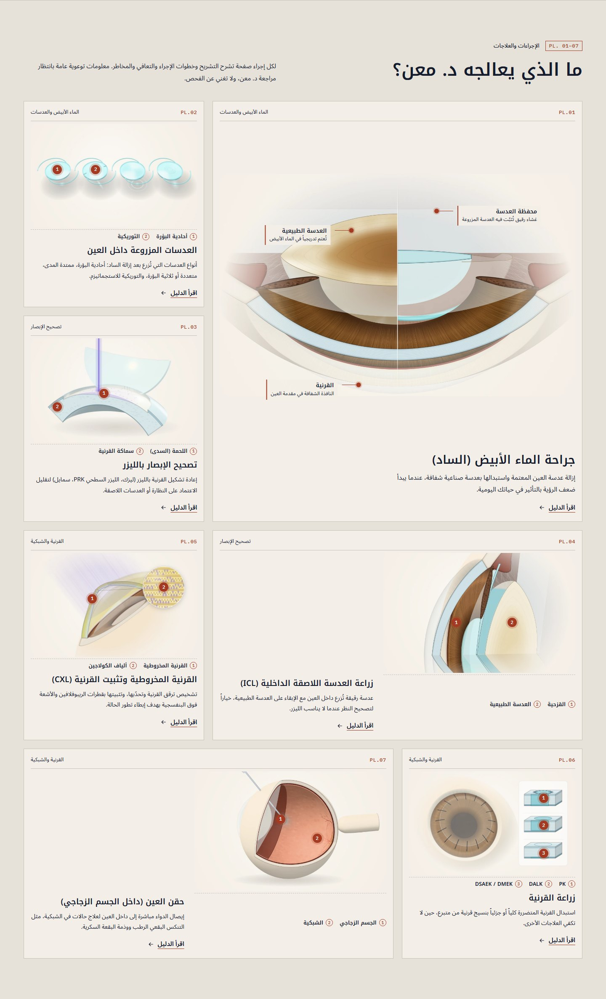
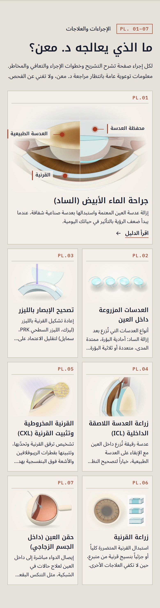
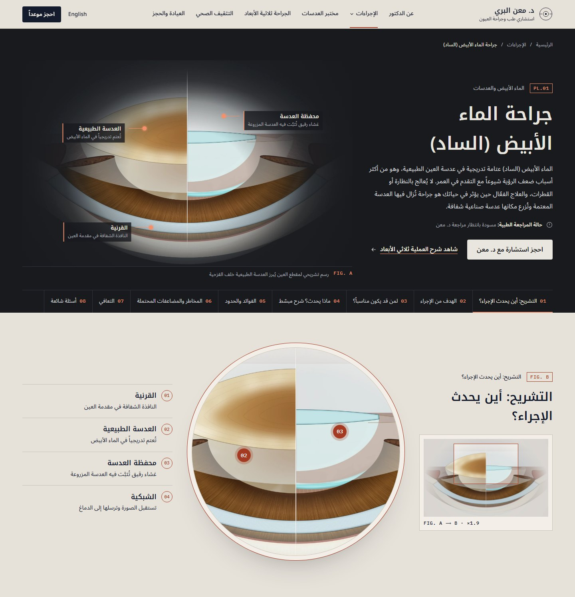
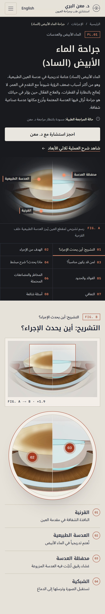
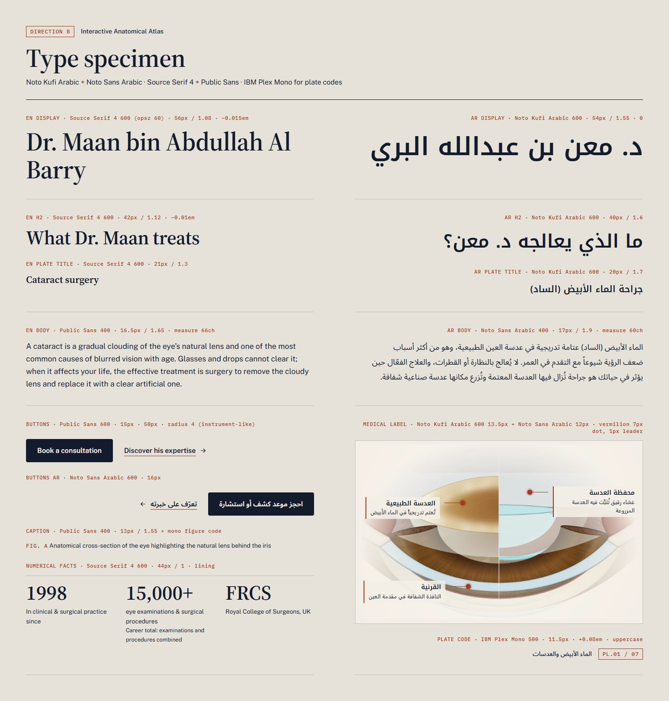
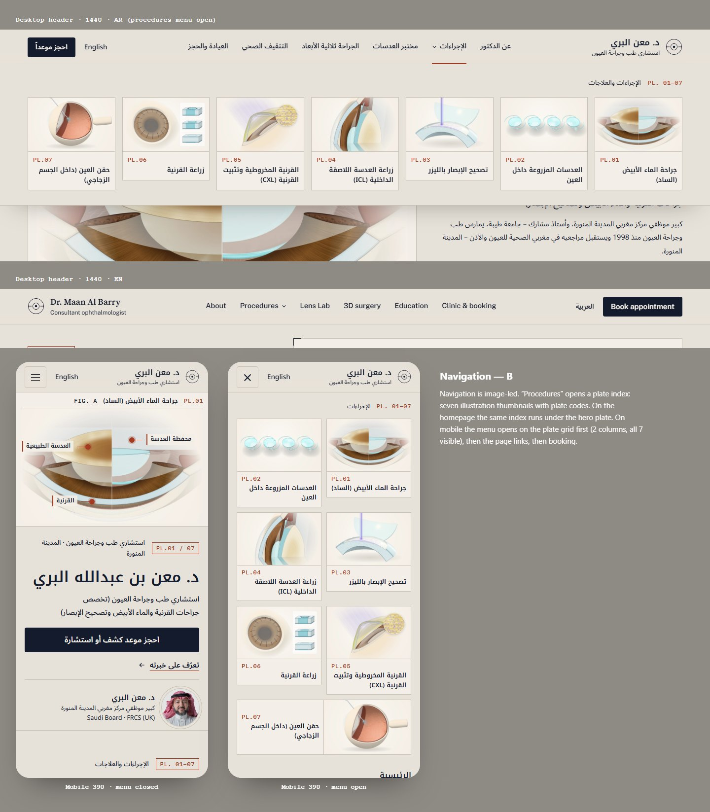
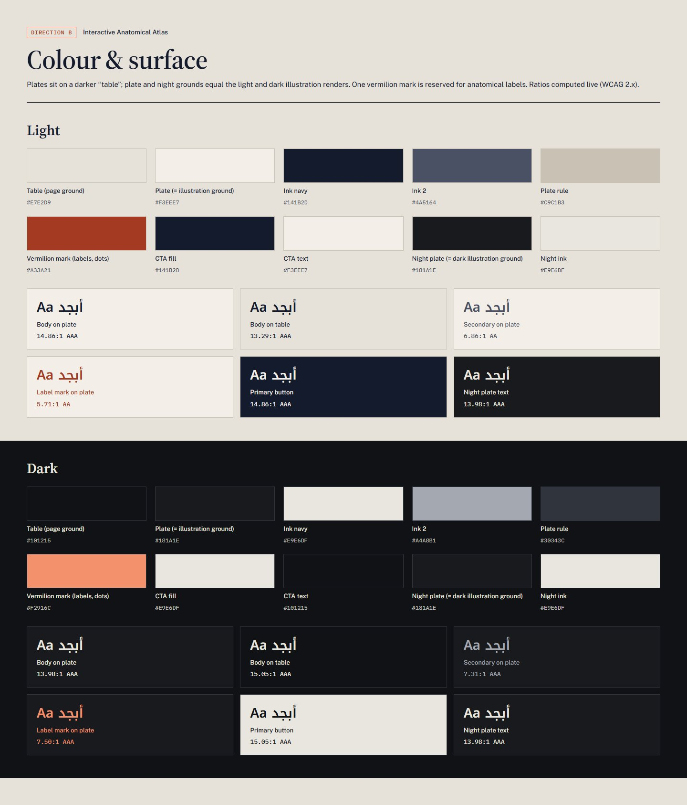

### Strengths

- It makes the best use of the one asset class the site has in quality: the 1600 px renders.
- It is the most distinctive and the most clearly "ophthalmology" of the three. No other medical site in the benchmark looks like this.
- It is the strongest teaching device. The labels explain the anatomy before the patient reads any text.
- Low-resolution portrait problem solved. The portrait is downscaled into a 76 px circle (0.64× at DPR 1, about 1.3× at DPR 2), so it stays crisp.

### Weaknesses and risks

- **Doctor identity is the weakest of the three.** The doctor becomes a signature line. The brief and the matrix (H7) want a portrait-led identity, and B underplays it.
- **Hierarchy.** The first screen splits attention three ways: the plate, the name and the 7-item index. Some index names wrap to 3 lines at 1440.
- **Maintenance.** Every illustration needs hand-placed label coordinates, kept in sync across the light and dark renders. If the art changes, the labels break. The labels also need medical sign-off.
- **Accessibility.**
  - Label text drops to 11.5–12 px on mobile.
  - Information inside the images must also exist as text. The legend and anatomy list do this, and so do `alt` text and the "sr" spans on the pins.
  - Pins are not interactive in the prototype. If they become interactive, each needs a 44 px target.
- **RTL.**
  - Labels are physical, and their text uses `plaintext` bidi.
  - The mono plate codes are Latin and LTR even on Arabic pages. That reads as a deliberate scientific notation, but some readers may see it as untranslated text.
  - The Kufi display face needs line-height 1.6, which makes the Arabic H1 tall.
- **Contrast, measured with WCAG 2.x:**

  | Pair | Light | Dark |
  |---|---|---|
  | Body on plate | **14.86:1** | 13.98:1 |
  | Body on table | 13.29:1 | 15.05:1 |
  | Secondary on plate | **6.86:1** | 7.31:1 |
  | Vermilion label on plate | **5.71:1** | 7.50:1 |
  | Night text | 13.98:1 | – |
  | Button | 14.86:1 | – |

### Implementation cost (vanilla JS/CSS)

**Medium to high.**

- A label-anchor dataset is needed per procedure. It belongs beside `anatomy.parts` in `src/procedures/content.js`.
- New components are needed: leader labels, the pin-and-legend pair, the loupe, the plate frame and the plate index.
- The labels need collision QA at 3 breakpoints and in 2 themes.
- 4 font families (Kufi, Noto Sans Arabic, Source Serif, Plex Mono) is the heaviest load of the three.
- The hero eagerly loads one 1600 px plate plus 7 thumbnails, about 80 kB + 7 × 15–30 kB of WebP. That is acceptable but must be watched.

### Simulator skinning

This is the most natural fit of the three:

- Light Journey **is** an atlas plate: the same vermilion labels, now stepping through stations.
- The cataract 3D stages become "Fig. 1–4" with mono stage codes.
- Lens Lab becomes a row of comparative plates (monofocal, EDOF, trifocal, toric).
- The vision simulator becomes a before/after plate with a labelled split. That is the comparison slider recommended by the 21st research.

---

## Direction C: Modern Patient Experience ("Care, clearly")

**Concept.** The design is task-first and welcoming. The first screen answers three things at once: who the doctor is, which procedure the patient needs, and how to book. It is clean and white, with a cool mist gradient and one lagoon-teal primary used for every action. It uses soft radii, image-led cards, a segmented filter and a **service finder**. On mobile it adds a persistent bottom bar (Book · Call · WhatsApp) and a bottom-sheet menu.

**Rationale.**

- **The most direct fix for R2, R9 and R10.** Booking routes (online, clinic line with WhatsApp, call centre) sit in the first screen. That reuses the verified H25 methods.
- **The four non-diagnostic pathways from the matrix (H9)** appear on mobile as a 2×2 grid with no hidden scroller.
- **All 7 procedures** appear as chips with thumbnails in the finder and as cards in the bento.
- **The reference card language (R6)**: radius 24–28 and a soft shadow.
- **The research's numbered timeline (R11)** is used for "What happens" on the procedure page.

### The 10 elements

| Element | C |
|---|---|
| Hero | Start side: a location pill, a 54 px Alexandria H1, the title, the intro, a teal pill CTA and a tonal secondary. End side: a **doctor card** with the portrait at native size on its own grey ground, name, role, chips (FRCS (UK), Saudi Board, Associate Professor – Taibah University) and clinic hours. Below: the **finder**, which holds the "Start from what you need" segmented control (all procedures plus 3 groups) and 7 procedure chips with thumbnails, alongside a "Ways to book" panel. |
| Procedure gallery | A 4-column bento. Cataract is the lead card (2×2) with a "3D" badge and the 3D link. Lens implants, laser, ICL and CXL take 1×1 cards. Corneal transplant and injections take 1×1 cards next to a teal "Not sure? Start with an examination" card (real L4 copy). A segmented filter sits in the section head. |
| AR type | **Alexandria** 600 for display (54 / 42 / 19–26 px; line-height 1.45–1.6). **Readex Pro** 400 for body, 15–17 px at 1.85. |
| EN type | **Manrope** 800 for display (58 px at 1.06, −0.03 em). **Manrope** 500 for body, 16.5 px at 1.65. |
| Colour and surface | Base #FFFFFF, mist #EEF4F3, lagoon #0B6E72, tint #E2F0EE, media well #F3EEE7 (the illustration ground), and an amber review note #7A4F00 on #FFF3D9. Dark: #0D1414 with lagoon #5CC2C3. |
| Image presentation | Illustrations sit in rounded sand "wells" inside white cards. The portrait is shown at its native size in the card. |
| Section layout | Max width 1328 and 56 px gutters. Cards use a 24 px radius and an 8 px inner inset. |
| Navigation | Pill nav links, the clinic line in the header and a filled "Book" button. "Procedures" opens a grouped menu (3 groups with thumbnails) with a help card. Mobile: a **bottom sheet** opens with 3 booking actions first, then the 7 procedures with thumbnails, then the pages. A persistent floating **Book · Call · WhatsApp** bar stays on screen. |
| Mobile composition | Name, title and 2 CTAs come first, then **4 pathway tiles**, then a compact doctor card. The gallery is a wrapping filter plus horizontal cards (104 px media, 2-line summary), with a full card for cataract. |
| Procedure-page hero | Group chip, a 48 px H1, the intro, an amber review note, then Book and WhatsApp. "On this page" appears as chips, or as a `
` on mobile. The media card carries **numbered hotspots** with a tooltip, plus a pressed-state legend. Then the close-up: a ×1.9 zoom card with pins numbered to match the hotspots, next to a **numbered vertical timeline** of the real steps. |

### Screenshots

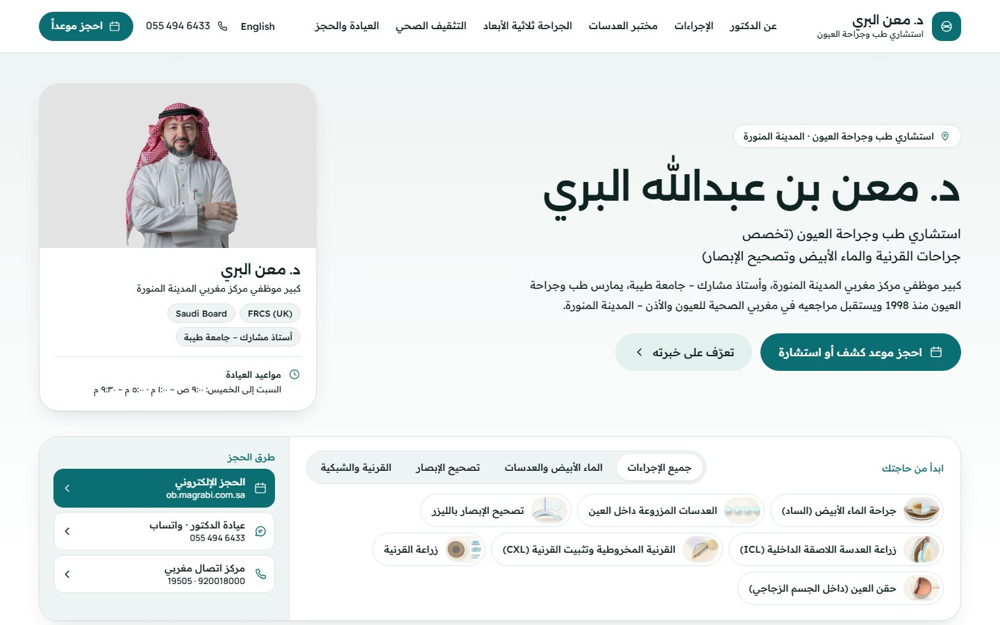
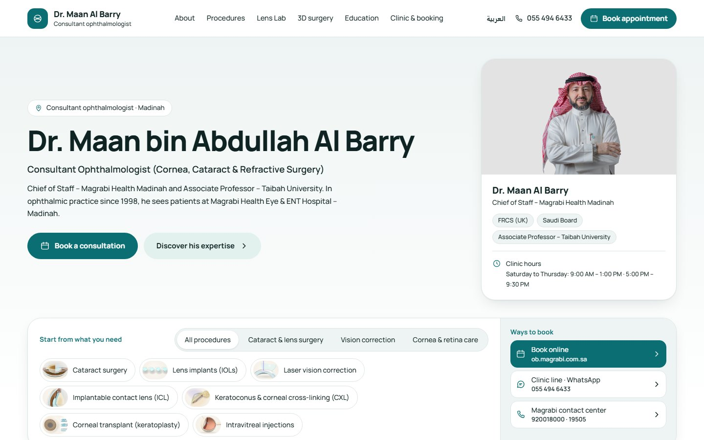
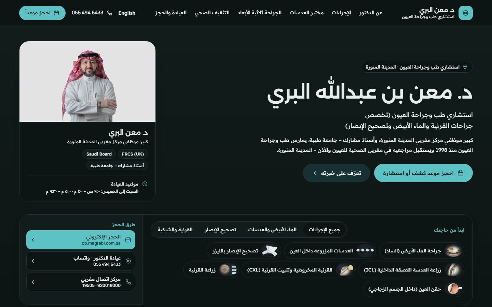
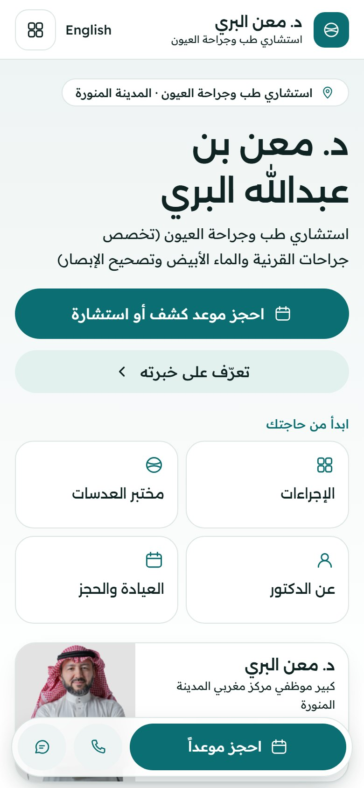
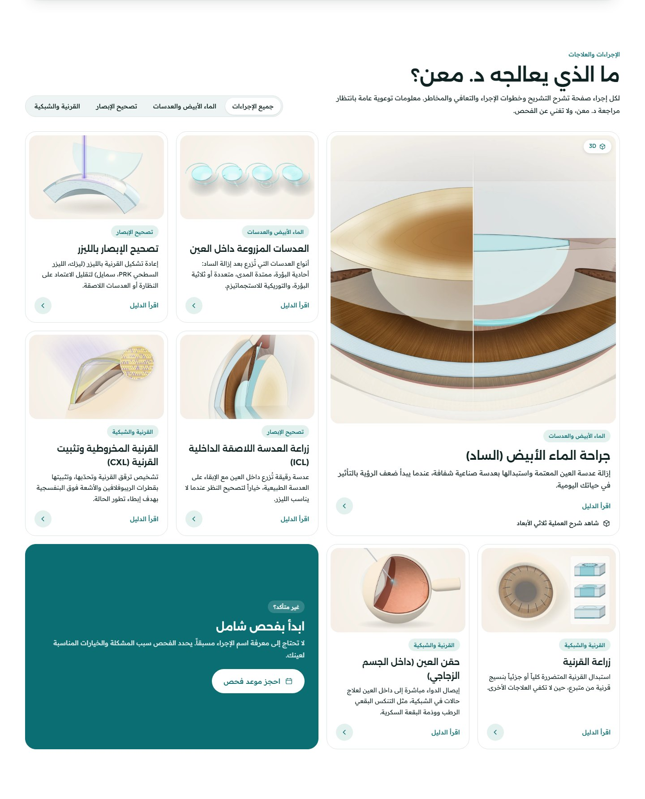
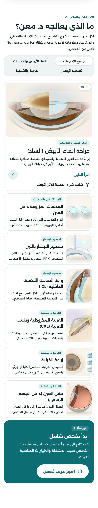
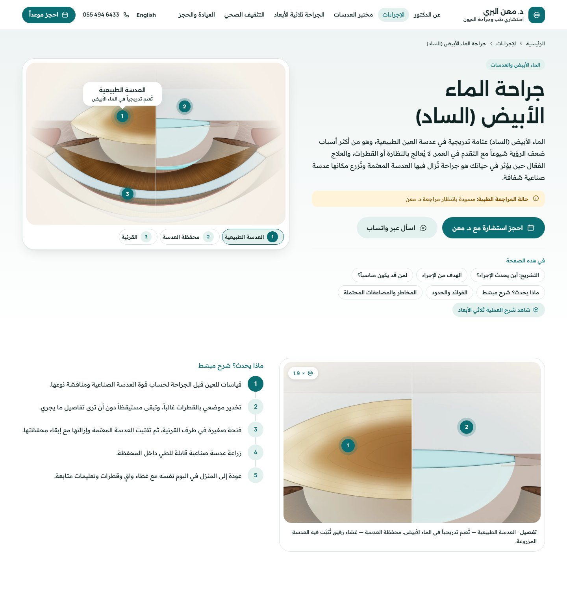
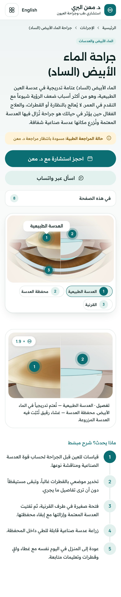
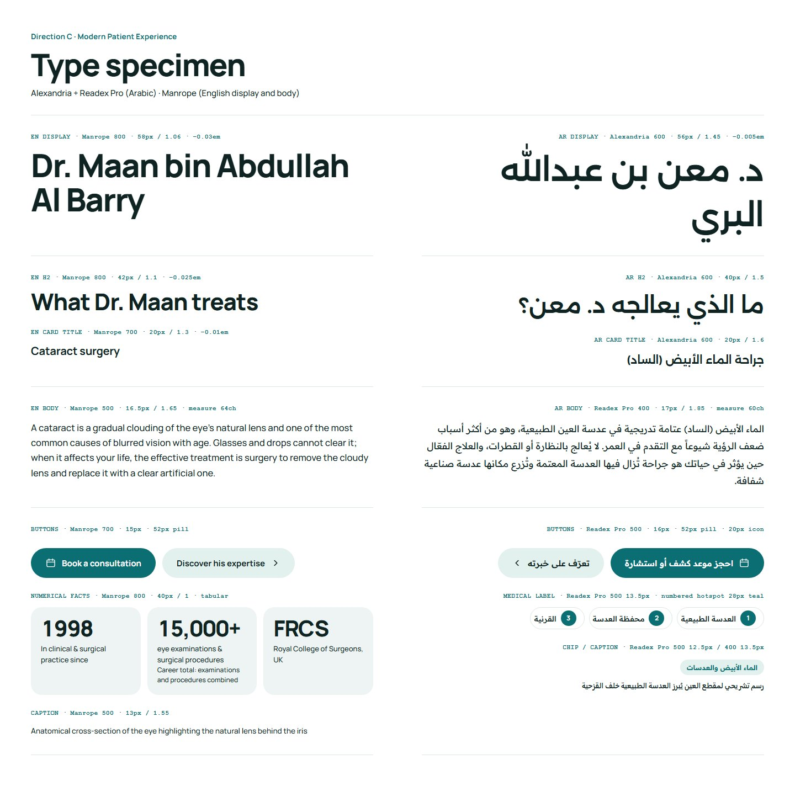
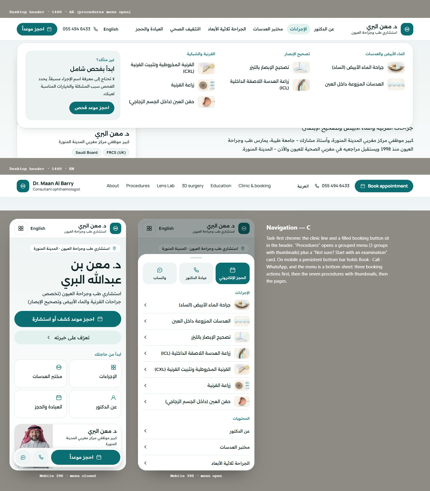
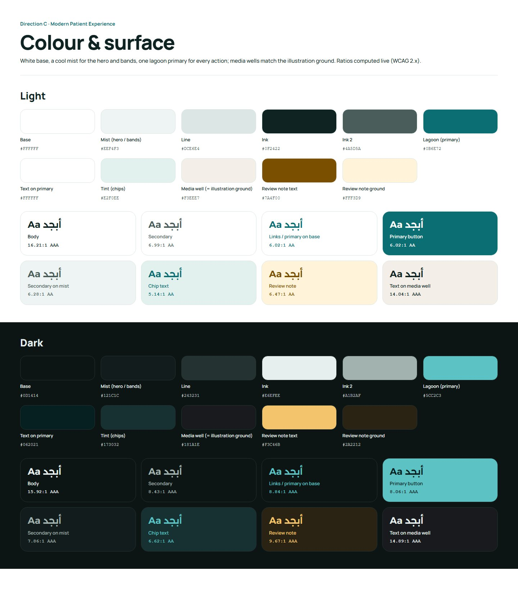

### Strengths

- It has the best mobile experience of the three. Booking is always one tap away, all 7 procedures are reachable in 2 taps, and the pathway tiles sit above the fold.
- Every first-screen element is actionable.
- The portrait is shown at its native size on desktop (1.0×), so it is the sharpest on a standard screen.

### Weaknesses and risks

- **Distinctiveness.** This is the closest of the three to familiar healthcare and SaaS UI. The owner has rejected "generic cards", and C is the direction most at risk of reading as a template.
- **Density.** The first screen is busy: hero, doctor card and finder together.
- **Typography.**
  - Manrope is common.
  - **Alexandria renders "عبدالله" with the Allah ligature** (a shadda and dagger alif form). In a personal name that may be unwanted. It can be suppressed with `font-feature-settings`, or avoided with another face.
- **Mixed digits.** The Arabic hours string in `doctor-data.js` uses Arabic-Indic digits (٩:٠٠), while every other number uses Western digits. The doctor card shows both side by side. This is a content inconsistency to resolve; it affects all three directions but is most visible in C.
- **Portrait on phones.** On mobile the portrait is downscaled to 206 px (about 1.4× at DPR 2), which is fine. In dark mode the grey #E3E3E3 photo band is a bright block.
- **Contrast, measured with WCAG 2.x:**

  | Pair | Light | Dark |
  |---|---|---|
  | Body | **16.21:1** | 15.92:1 |
  | Secondary | **6.99:1** | – |
  | Teal link | **6.02:1** | 8.84:1 |
  | White on teal button | **6.02:1** | 8.06:1 |
  | Chip | 5.14:1 | 6.62:1 |
  | Review note | 6.47:1 | 9.67:1 |

### Implementation cost (vanilla JS/CSS)

**Medium.**

- New JS is needed for the finder filter (one exists today as `filterProcedures`), the bottom sheet (focus trap, scrim, Escape key) and the sticky booking bar. A booking bar already exists as `renderBookingBar`.
- The bento needs a grid-areas layout and a mobile list variant.
- 2 font families, with Manrope covering English: the lightest load of the three.

### Simulator skinning

- Simulators become white cards with teal segmented controls.
- The vision simulator becomes the labelled comparison slider.
- Lens Lab shows one lens card at a time on mobile with chips. M22 already behaves this way.
- Light Journey stations use the same numbered teal hotspots as the procedure media.
- The cataract 3D stage sits in a rounded dark well with a pill stage bar.

---

## Comparison

Scores run from 1 (weak) to 5 (strong). They are my own judgement after looking at every rendered frame, not user-tested.

| Criterion | A Editorial | B Atlas | C Patient |
|---|---|---|---|
| Visual sophistication | **4**: restrained and typographic; nothing generic | **4**: plates, ticks and leaders feel crafted; slightly busy hero | **3**: polished but familiar app/SaaS look |
| Medical credibility | **4**: monograph tone and credentials ledger | **5**: anatomy explained with labels | **4**: clear, verified booking routes, review note visible |
| Doctor-specific identity | **4**: name-first, portrait-led, ledger, though the portrait is small | **2**: the doctor shrinks to a signature | **3**: doctor card with chips and hours |
| Typography | **5**: Naskh + Plex / Newsreader is the best bilingual pairing | **4**: Kufi is authoritative but cool; needs 1.6 line-height | **3**: Alexandria's Allah ligature; Manrope is generic |
| Image quality | **3**: renders bleed beautifully; portrait upscaled 1.36× | **5**: best use of the renders; portrait crisp in the circle | **4**: renders in wells; portrait at native size |
| Content hierarchy | **4**: name, CTA, ledger, then chapters | **3**: plate, name and index compete | **4**: tasks are clear, though the first screen is dense |
| Mobile suitability | **3**: portrait below the fold, long page | **4**: plate-first; 2-column plate grid | **5**: bottom bar, sheet, pathways, compact cards |
| Arabic RTL quality | **5**: Naskh display reads most natively | **4**: correct, but Latin mono codes and tall Kufi | **4**: correct; ligature and mixed-digit issues |
| Accessibility | **4**: all pairs ≥ 5.85:1; small 12.5 px captions | **3**: 11.5–12 px labels; information on images must be duplicated | **4**: all ≥ 5.14:1; large targets; summaries clamped |
| Maintainability | **4**: fewest components | **3**: per-illustration label coordinates | **4**: standard components |
| Performance | **4**: 3 families, no extra JS | **3**: 4 families plus an eager large plate and 7 thumbnails | **4**: 2 families; small thumbnails |
| Integration with simulators | **3**: needs its own "plate" chrome | **5**: the simulators already are plates | **4**: card and segmented-control language fits |
| Distinctiveness | **4**: rare for a clinic site | **5**: unique in the benchmark | **2**: closest to templates |
| **Total (of 65)** | **51** | **50** | **48** |

## Recommendation

My recommendation is **A as the base, with B's plate language on procedure surfaces and C's mobile booking utilities.** The totals are close, so this is a judgement call rather than a clear winner.

- **Keep from A:** the type system (Naskh + Plex Sans Arabic, Newsreader + Plex Sans), the ivory and ink colours, the numbered chapters, the name-first hero and the credentials ledger. It is the only direction that is both distinctive and calm, and it answers the "not template-looking" objection most convincingly.
- **Take from B:** the labelled plate treatment and the loupe close-up, for the procedure gallery's lead item and for every procedure page. Restyle them in A's ink and bronze in place of vermilion, and keep pins plus legend on the small items. That is where B's strength in explaining anatomy matters most, without costing the homepage its doctor identity.
- **Take from C:** the persistent mobile bar (Book · Call · WhatsApp), the bottom-sheet menu that puts booking actions first, and the 2×2 non-diagnostic pathways. These fix A's weakest score, mobile.

Risks of the hybrid:

- Mixing directions can dilute each one. A must keep control of tokens and type; B and C contribute components, not styling.
- **None of the directions fully solves the portrait.** A new professional portrait, at 1600 px or more on a neutral ground with written consent, would lift A more than any CSS can.
- If no new portrait is possible, B's approach is the honest one: keep the doctor's photo small and crisp, and let the anatomy carry the visual weight.

If the owner wants one pure direction instead of a hybrid, choose **A**. Choose **B** if the priority is a site that looks unlike any other clinic site, accepting the weaker doctor presence.

## What these prototypes do not show

- Body sections beyond the hero and gallery: credentials, education, FAQ, clinic and the footer.
- Real interaction: filters, hotspots and menus are static states, toggled by query string.
- Font self-hosting and its performance.
- Real-device checks, screen-reader passes and a formal axe run on the prototypes.
- Label positions: they are agent-placed and **need medical review**.
